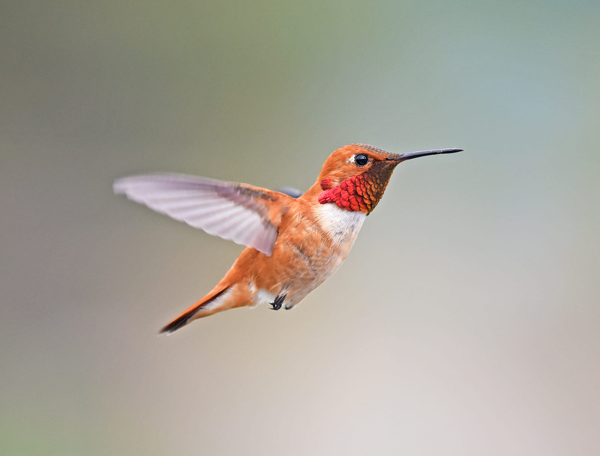
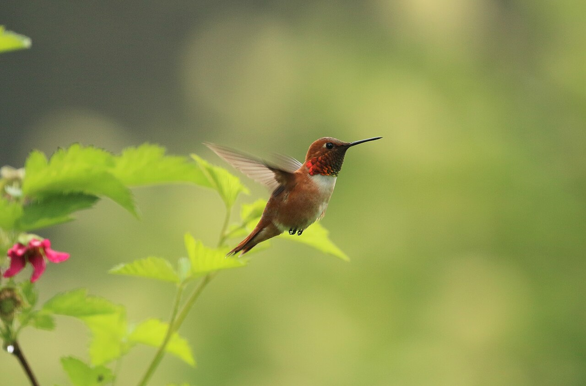
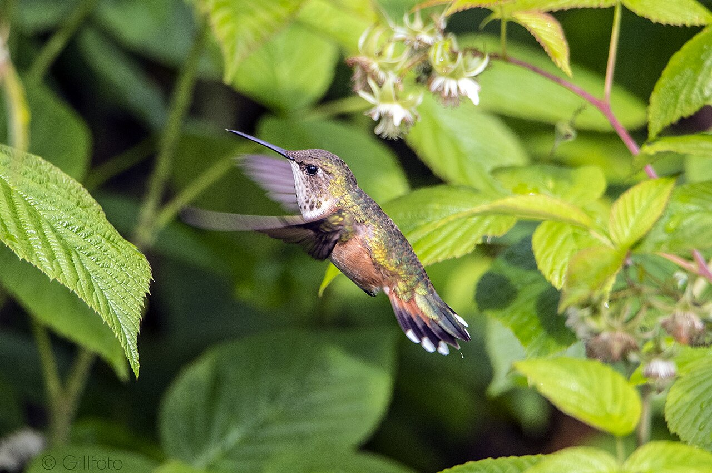
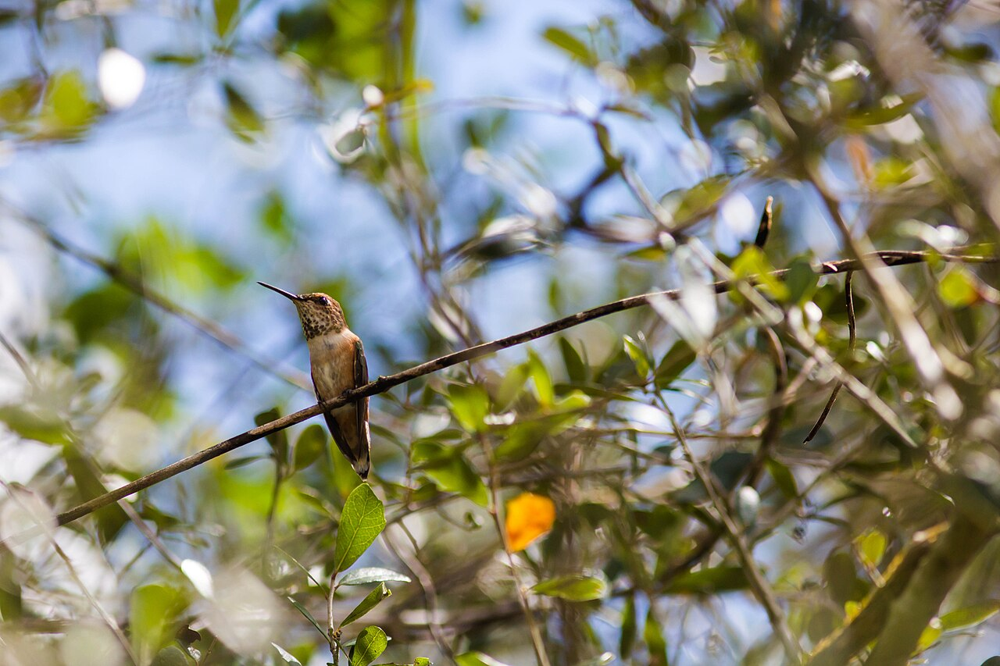

It might be, and in Georgia in December it probably is. A hummingbird at a feeder that late is the bird [Georgia DNR](https://gadnrle.org/sites/default/files/wrd/pdf/fact-sheets/hummingbirdsofGeorgia.pdf) lists as the state's most common wintering hummingbird: the Rufous. The same fact sheet says Ruby-throated Hummingbirds are rare in Georgia past October 31, and that most Ruby-throats that do stay are along the coast. [Audubon](https://www.audubon.org/field-guide/bird/rufous-hummingbird) calls the Rufous the western hummingbird that wanders east most often, with many east of the Mississippi every fall and winter. Georgia DNR biologists, quoted in the [Statesboro Herald](https://www.statesboroherald.com/local/keep-those-feeders-up/), say a few birds on the trip from the Pacific Northwest and Alaska toward Mexico take another route and spend the winter here. Black-chinned Hummingbirds are next on the Georgia list, at fewer than five reports a winter. Allen's has fewer than a dozen Georgia records in all. Photograph the back, the throat, and the tail before you settle the name. The [species guide](/species) puts the four hummingbirds of a southeastern yard side by side.

## What makes a Rufous Hummingbird so striking?

An adult male in good light is the hummingbird that looks like a new copper penny. [Cornell](https://www.allaboutbirds.org/guide/Rufous_Hummingbird/id) says males are bright orange on the back and belly, with a vivid iridescent-red throat, and that most have a rusty back and tail. [eBird](https://ebird.org/species/rufhum) describes an adult male as almost entirely orange, with a bright white chest. The gorget moves with the light: Cornell and eBird both say it can read red, orange, yellow, or lime, and it can look dark when the light misses it. Georgia DNR's plate is the same bird: a reddish-brown back, rump, tail, and sides, and an orange-red gorget.

Adult male Rufous Hummingbird, western Washington, 22 May 2018. The back is rufous from the crown through the tail, the mark that separates most adult males from Allen's Hummingbird. Photo: VJAnderson, <a href="https://creativecommons.org/licenses/by-sa/4.0/">CC BY-SA 4.0</a> (resized), via <a href="https://commons.wikimedia.org/wiki/File:Rufous_Hummingbird,_male_01.jpg">Wikimedia Commons</a>.

Cornell's [overview](https://www.allaboutbirds.org/guide/Rufous_Hummingbird/overview) calls it one of the feistiest hummingbirds in North America. Males and females attack other hummingbirds at flowers and feeders, including birds twice their weight, and they have been seen chasing chipmunks from a nest. Audubon describes a male holding a patch of flowers against larger birds. On a December feeder, one Rufous can own the yard.

Adult male Rufous Hummingbird, 25 May 2020. Photo: Forest Service Alaska Region, USDA. Public domain (U.S. government work), via <a href="https://commons.wikimedia.org/wiki/File:Male_Rufous_Hummingbird.jpg">Wikimedia Commons</a>. Resized for this page.

The flight is enormous for a bird just over 3 inches long. Cornell says the Rufous makes one of the longest migratory journeys of any bird as measured by body size: roughly 3,900 miles one way from Alaska to Mexico, north along the Pacific in spring and south through the Rockies in late summer ([range map](https://www.allaboutbirds.org/guide/Rufous_Hummingbird/maps-range)). It breeds farther north than any other hummingbird, to southeastern Alaska. [UF/IFAS Leon County](https://blogs.ifas.ufl.edu/leonco/2013/12/26/winter-hummingbirds/) reports a female banded by Fred Dietrich in Tallahassee in mid-January and recaptured in Alaska on June 28 of the same year, 3,523 miles. Cornell's [life history](https://www.allaboutbirds.org/guide/Rufous_Hummingbird/lifehistory) puts the wider picture next to that: an Orange Alert Tipping Point species in the 2025 State of the Birds report, with an estimated 2.2 percent annual decline from 1968 to 2023 and a cumulative loss of 72 percent. Audubon lists it as Near Threatened.

## How do I tell a Rufous from a Ruby-throated?

Start with the back of an adult male. A Rufous male is orange-rufous above. A Ruby-throated male is emerald or golden-green above, with gray-white underparts and a red throat that looks black until it catches the light ([Cornell, Ruby-throated](https://www.allaboutbirds.org/guide/Ruby-throated_Hummingbird/id)). Cornell lists both at 2.8–3.5 inches, so size will not separate them, and both throats go dark in flat light.

Females and immatures are the usual December birds. Cornell describes a female or immature Rufous as greenish above, with rusty flanks, rusty patches in the green tail, and often an orange throat spot. Georgia DNR's adult female matches that: green back, light brown sides, reddish flecks that can form a central spot, and brown in the tail. A female Ruby-throated is golden-green above and whitish below, with buffy flanks and no red throat. Cornell's [comparison](https://www.allaboutbirds.org/guide/Rufous_Hummingbird/species-compare/) states the flank difference directly: mostly grayish on a Ruby-throated, coppery on a Rufous.

<table>
  <thead>
    <tr>
      <th>Field mark</th>
      <th>Rufous Hummingbird</th>
      <th>Ruby-throated Hummingbird</th>
    </tr>
  </thead>
  <tbody>
    <tr>
      <td>Adult male back</td>
      <td>Bright orange to coppery rufous on most birds. A minority of males are green-backed.</td>
      <td>Emerald or golden-green.</td>
    </tr>
    <tr>
      <td>Adult male throat</td>
      <td>Iridescent red to orange. The angle can turn it yellow or lime, or leave it dark.</td>
      <td>Brilliant ruby red, black or dark red until the light hits it.</td>
    </tr>
    <tr>
      <td>Female and immature</td>
      <td>Green above, rufous flanks, rufous in the tail, spotted throat that often has an orange center.</td>
      <td>Green above, whitish underparts, buffy or grayish flanks, no red gorget.</td>
    </tr>
    <tr>
      <td>In Georgia in December</td>
      <td>The most common wintering hummingbird in the state.</td>
      <td>Rare past October 31. Most that do winter are along the coast.</td>
    </tr>
  </tbody>
</table>

Female or immature Rufous Hummingbird, Juneau, Alaska, 29 June 2018. Green back, spotted throat, rufous flanks, and rufous at the base of the tail with white tips. This plumage overlaps Allen's Hummingbird; Allen's does not occur in southeast Alaska. Photo: Gillfoto, <a href="https://creativecommons.org/licenses/by-sa/2.0/">CC BY-SA 2.0</a> (resized), via <a href="https://commons.wikimedia.org/wiki/File:Humming_Bird_sideon_920_%2843388670332%29.jpg">Wikimedia Commons</a>.

Allen's is the catch. Most adult males separate on the back: bronze-green on Allen's, copper on Rufous. Some male Rufous are green-backed, and Cornell says those males, plus females and immatures, come down to the spread outer tail feathers, narrow on Allen's and broad on Rufous. Cornell calls females and immatures very difficult to separate. Georgia DNR says an adult female Allen's cannot be safely separated from a female Rufous in the field, and that many winter birds cannot be named unless captured and examined. In Alabama, Georgia, Florida, Mississippi, and Tennessee, [Hill, Sargent, and Sargent (1998)](https://digitalcommons.usf.edu/auk/vol115/iss1/40) found about 95 percent of the Selasphorus they banded were Rufous, against eight Allen's.

Female or immature Rufous/Allen's-type hummingbird, 27 February 2017. The bird is distant: a spotted throat, greenish upperparts, and rufous on the flank. Those marks fit a winter Selasphorus and do not separate Rufous from Allen's. Wikimedia Commons files the photograph under Birds of Florida and labels it a Rufous Hummingbird; the photographer's caption does not name a town. Photo: Melissa McMasters, <a href="https://creativecommons.org/licenses/by/2.0/">CC BY 2.0</a> (resized), via <a href="https://commons.wikimedia.org/wiki/File:Rufous_hummingbird_%2833148123801%29.jpg">Wikimedia Commons</a>.

## Why are more Rufous Hummingbirds wintering in the Southeast?

The first winter Rufous east of the Mississippi was at Charleston, South Carolina, on 18 December 1909. Hill, Sargent, and Sargent counted 68 sightings east of the river from 1909 through 1979. From the winter of 1990–91 through 1995–96, in only Alabama, Georgia, Florida, Mississippi, and Tennessee, 1,643 Selasphorus hummingbirds were reported, and between 7 September 1988 and 13 January 1996 they banded 358 Rufous there. Dozens wintered inland at Huntsville and Atlanta, about 400 kilometers from the Gulf, not only on the coast the 1980s guides described.

They also recorded the bias. More people could name a Rufous after the 1970s, and from 1988 the Sargents asked homeowners to leave feeders up. Detection rose by an unknown amount. The other western hummingbirds got the same new attention and did not surge: two Anna's, four Calliope, four Buff-bellied, and eight Allen's in the years with more than 1,500 Rufous, and 34 Black-chinned from 1988 to 1995 with no upward trend. Hill, Sargent, and Sargent argued that yards, winter flowers, insects, and feeders had made the Southeast usable, and they left the mechanism open: a learned route, a genetic change in direction, or birds that reached Mexico and then wandered northeast. Most winter residents were first seen in November or December, weeks after Rufous had left the West.

Later accounts still divide. [Operation RubyThroat](https://www.rubythroat.org/ResearchHummerVagrantMain.html) says the East sees Rufous more regularly, perhaps because more feeders stay up. [Project FeederWatch](https://feederwatch.org/learn/articles/hummingbirds-in-winter/) says banders take dozens each winter and that a true increase is still uncertain, because more people are looking. [Audubon](https://www.audubon.org/magazine/rufous-hummingbirds-turning-unusual-places) quotes LSU's Van Remsen, "We've set the table for them," on feeders, gardens, and milder winters, and quotes Bob Sargent saying the birds may have been overlooked for decades. Remsen calls a climate explanation tenuous.

## When do they arrive, and when do they leave?

<table>
  <thead>
    <tr>
      <th>When</th>
      <th>What the records describe</th>
    </tr>
  </thead>
  <tbody>
    <tr>
      <td>Late July and early August</td>
      <td>Gulf coasts of Mississippi, Alabama, and northwest Florida: adult males first, often for a day or two, then immatures, then adult females. Many are passing migrants.</td>
    </tr>
    <tr>
      <td>August in Georgia</td>
      <td>Georgia DNR biologists say western visitors may arrive as early as August.</td>
    </tr>
    <tr>
      <td>November and December</td>
      <td>Most Rufous that stay the winter are first detected then, weeks after the species has left the West.</td>
    </tr>
    <tr>
      <td>December through February</td>
      <td>Project HUMMER says most winter hummingbirds show up in these months. Around Tallahassee, December and January are the most likely, and Rufous is the most common winter hummingbird.</td>
    </tr>
    <tr>
      <td>Late March and early April</td>
      <td>Georgia DNR biologists say winter visitors may stay into late March or early April. Ruby-throated Hummingbirds return to Georgia in that same window, according to UGA Extension.</td>
    </tr>
  </tbody>
</table>

Hill, Sargent, and Sargent could not find a late-winter movement back up the Gulf, and they left the route off the winter grounds unknown. The [migration guide](/migration) is the Ruby-throated calendar. The [seasonal calendar](/seasonal-calendar) covers the winter months, when a Rufous is the bird to expect.

## How do they handle the cold?

[Southeastern Avian Research](https://southeasternavianresearch.org/hummingbirds/) says these western birds are not lost. They are cold-hardy, many stay in one yard all winter, and some return to the same house in a later year. If the yard stops paying, they leave. Audubon's Gulf Coast account, drawing on Scott Weidensaul, says the tougher western species, Rufous among them, can survive below 0°F by slowing metabolism sharply, while a freeze that deep is likely to kill a Ruby-throated. [Alabama Cooperative Extension](https://www.aces.edu/blog/topics/forestry-wildlife/hummingbirds-in-alabama/) describes that torpor for hummingbirds generally: body temperature and heart rate drop, and breathing falls to about 5 percent of the sleeping rate for a bird that size. They wake fast, so the danger is a feeder still frozen at dawn.

Cornell says they also take gnats, midges, flies, and aphids, and UF/IFAS Leon County adds sapsucker wells and winter flowers. A 4-to-1 mix of water to white sugar starts to freeze at 27°F: slush above that, solid ice after a colder run (Southeastern Avian Research). Bring the feeder in at dark and hang it before first light. The [winter feeder guide](/blog/leave-hummingbird-feeder-up-winter-southeast) covers changes and a two-feeder swap.

## What should I do if I see one?

Leave one feeder up with 1 part white sugar to 4 parts water, and no red dye. The December bird is already here. [UGA Extension](https://site.extension.uga.edu/paulding/2026/02/hummingbirds-will-be-back-soon-are-you-prepared/) says to keep at least one feeder up all year. If a bird is using it, Southeastern Avian Research says change the nectar every 3 to 4 days. If no bird has found it, fill the feeder only partway.

Report the sighting. December sits inside each of these windows:

- [Southeastern Avian Research](https://southeasternavianresearch.org/hummingbirds/) wants any hummingbird from November 1 through March 15. For Georgia it lists Emma Rhodes and Kyle Shepard at the Banding Coalition. Banding happens only if you agree. They still want the sighting if you decline.
- [Project HUMMER](https://www.bandingcoalition.org/projecthummer) uses November 15 through March 1. Kyle Shepard covers Alabama, Georgia, and Florida; Fred Dietrich covers Tallahassee and southern Georgia; Emma Rhodes covers the Atlanta area. The usual birds they see are Rufous and Black-chinned.
- Georgia DNR's fact sheet asks for rare and unusual winter reports at (478) 994-1438 or (478) 994-2568. Todd Schneider told the Statesboro Herald that backyard reports are how the state learned these species were wintering here.
- Add a checklist in [eBird](https://ebird.org/species/rufhum). A sunny photo of the back, the throat, and the tail gives a bander something to use even if nobody can visit.

Many Decembers the feeder stays empty. That quiet feeder is how this bird gets found.
